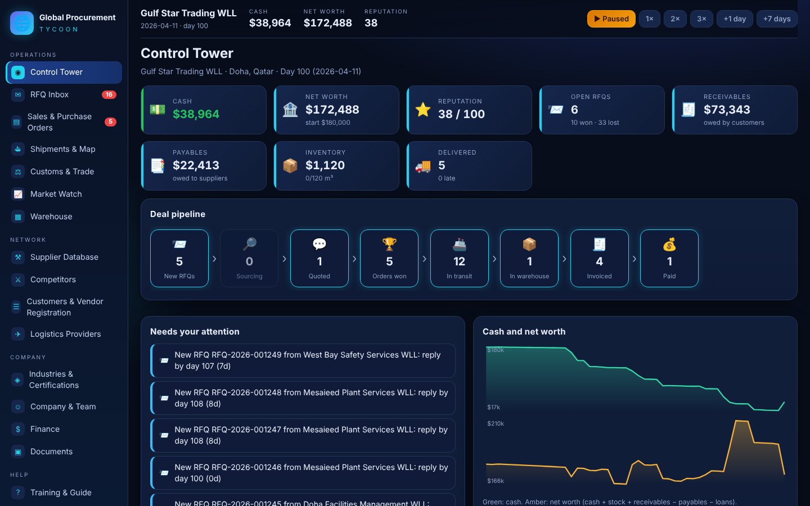
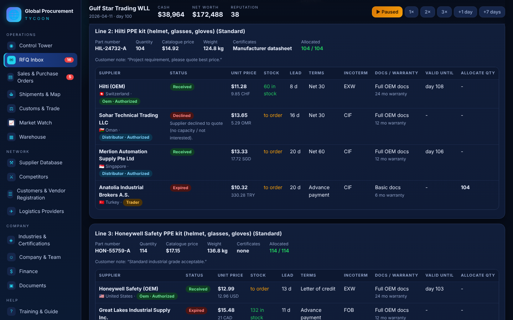
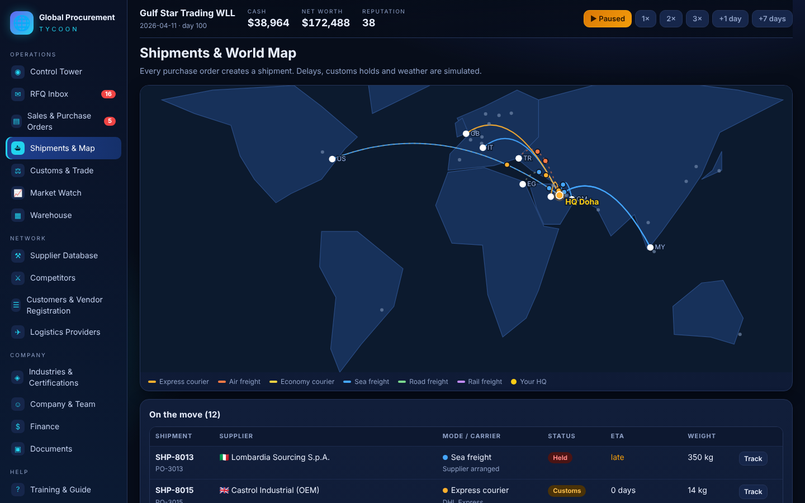
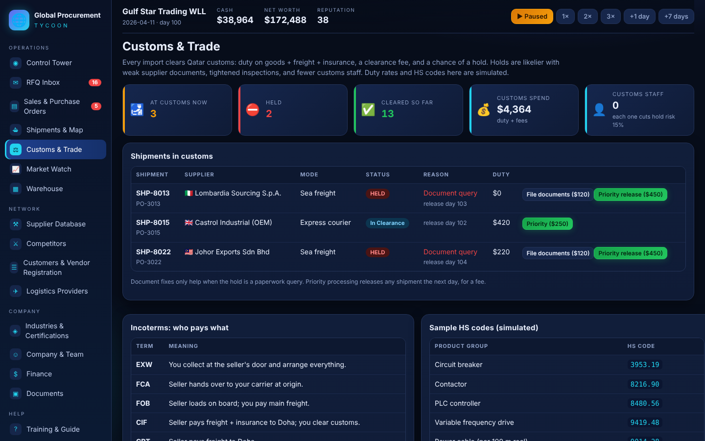
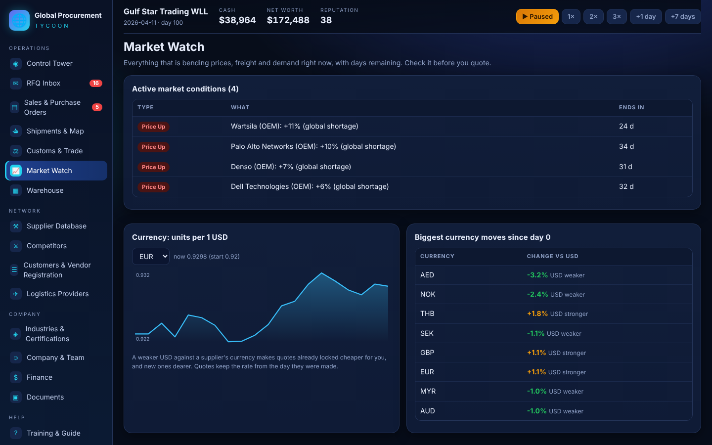
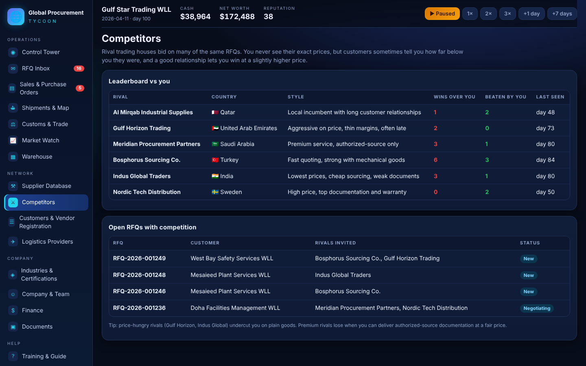
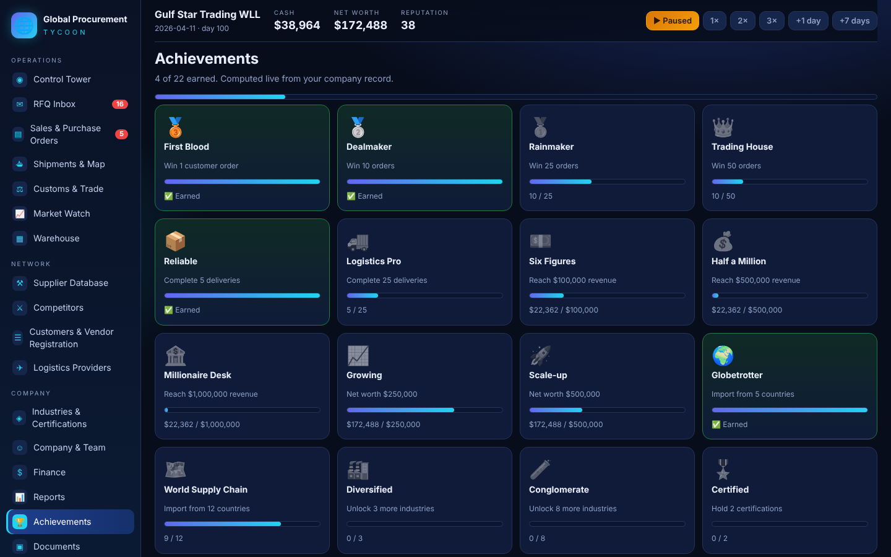
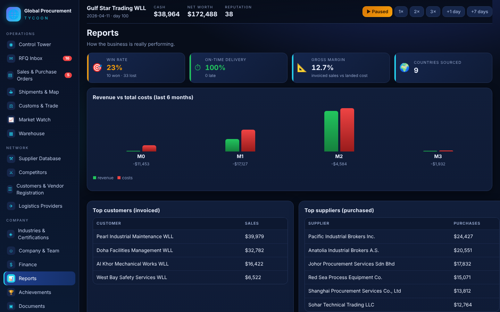

<div align="center">

# 🌐 GLOBAL PROCUREMENT TYCOON

### Start a one-desk trading company in **Doha, Qatar**. Source from the world. Don't go broke.

[](https://luciferalive.github.io/GLOBAL-PROCUREMENT-TYCOON/)




**515 suppliers · 320 customers · 55 freight providers · 2,223 parts · 29 countries · 6 rivals**

</div>

> 🎮 **Play:** enable GitHub Pages once (**Settings → Pages → Branch `main` → folder `/docs`**) and the game lives at the ▶ PLAY NOW link above. No install, no server, no sign-up.

---

## 🧭 What is this?

A customer emails you an **RFQ** (request for quotation). You hunt suppliers across the globe, haggle, work out the *true* cost of getting the goods to Doha, quote a price that wins **and** earns a profit, ship it, clear customs, deliver, and chase the payment. Win enough and you unlock new industries, bigger customers and a bigger warehouse. Misjudge freight, duty or cash flow and the bank freezes your account.

It is a real procurement cycle, not a clicker. Every number comes from one connected simulation engine.

## 🔁 One deal, start to finish

```mermaid
flowchart LR
  A[📨 RFQ arrives] --> B[🔎 Ask suppliers]
  B --> C[🤝 Negotiate price & credit]
  C --> D[🚢 Pick freight]
  D --> E[🧮 Landed cost]
  E --> F[💬 Quote the customer]
  F -->|rivals may undercut| G[🏆 Order won]
  G --> H[💳 Place POs]
  H --> I[🛃 Customs]
  I --> J[🔍 Inspect stock]
  J --> K[📦 Deliver]
  K --> L[🧾 Invoice]
  L --> M[💰 Get paid]
```



## 🧮 The number that decides everything

```
Landed cost = purchase price + freight + insurance + import duty
              + clearance + local transport + bank charges
Sell above it. Always. Then check how much cash you must pay BEFORE the customer pays you.
```

## ✨ Features

| | |
|---|---|
| 🏭 **Living database** | OEMs, authorized distributors, risky traders and local stockists, each with its own price level, lead time, payment terms, document quality and reliability. |
| 📨 **Real RFQs** | Several lines each, certificates required, urgent buyers, generic alternatives that need customer approval. |
| 🤝 **Negotiation** | Haggle price and credit terms with suppliers. Customers have personalities: price hawks, relationship builders, certificate sticklers, OEM-only purists, emergency buyers. |
| 🚚 **Freight engine** | Express, air, economy courier, sea, road, rail. Weight limits, dangerous goods, heavy cargo, fuel surcharges, insurance. |
| 🛃 **Customs & Incoterms** | EXW to DDP decide who pays what. Holds, document queries, priority release, duty on goods + freight + insurance. |
| ⚔️ **Rivals** | Six competing trading houses bid on the same RFQs. Lose by 6% and the customer will tell you. |
| 📈 **Market Watch** | Port strikes, airspace limits, component shortages, price hikes, demand booms, FX swings, port congestion. All with a countdown. |
| 🗺️ **World map** | Animated routes for every shipment, coloured by transport mode. |
| 📄 **18 document types** | RFQ, quotations, POs, packing lists, bills of lading, customs declarations, certificates of origin, invoices, receipts. Printable and stamped SIMULATED. |
| 🏦 **Letters of credit** | A bank LC facility ($60k, raisable to $260k with reputation): 10% cash margin, 1.2% fee, and document checks that punish traders with weak paperwork. |
| 🌍 **Export orders** | Foreign customers cost real outbound freight and export clearance, take longer to reach, and the cost shows up in the landed-cost table before you quote. |
| 🏭 **Warehouse network** | Open hubs in Dubai, Istanbul, Shenzhen, Rotterdam and Singapore: more capacity, shorter transit from the regions they serve, rent due every month. |
| 🏦 **Finance** | P&L, cash flow, bank loans, monthly payroll, 10% tax, prepay / LC / Net 30 / Net 60 terms. Bankruptcy is real. |
| 🏆 **Achievements & Reports** | 22 trophies with live progress bars, win rate, on-time delivery, gross margin, revenue vs cost charts, top customers and suppliers. |
| 🎓 **Training** | A 14-step campaign that ticks off as you do the real thing. |
| 💾 **Saves** | 5 slots plus autosave every 5 minutes, stored in your browser. |

## 📸 Tour

<table>
<tr>
<td width="50%"><br><b>The RFQ workbench:</b> quotes, allocation, landed cost, margin</td>
<td width="50%"><br><b>Live world map</b> with animated shipment routes</td>
</tr>
<tr>
<td><br><b>Customs & Trade:</b> holds, priority release, Incoterms</td>
<td><br><b>Market Watch:</b> active shocks and FX history</td>
</tr>
<tr>
<td><br><b>Competitors:</b> six rivals, one leaderboard</td>
<td><br><b>Achievements:</b> 22 trophies with progress</td>
</tr>
<tr>
<td colspan="2" align="center"><br><b>Reports:</b> revenue vs costs, top customers and suppliers</td>
</tr>
</table>

## 🕹️ Survival tips

1. **Never quote without opening Landed Cost.** Duty and freight eat thin margins alive.
2. **Cash is oxygen.** Prepay suppliers + Net 60 customers = a profitable company that still goes bust.
3. **Traders are cheap for a reason.** Weak documents get shipments held and certificate-hungry customers to walk.
4. **Watch Market Watch.** A port strike in Asia makes that cheap sea quote a trap.
5. **Relationships pay.** Loyal customers accept a slightly higher price. Rivals can't buy that.
6. **Don't stack orders you can't fund.** Late deliveries cost reputation, and reputation unlocks the big clients.

## 🗺️ Roadmap

- [x] **Stage 1:** core loop: RFQ → quotes → landed cost → negotiation → orders → shipping → warehouse → finance → training
- [x] **Stage 2:** customs actions, rival competitors, bill of lading / customs declaration / certificate of origin
- [x] **Stage 3:** world events and Market Watch, FX history, regional shipping disruptions, demand booms
- [x] **Stage 4:** achievements and business reports
- [x] **Stage 5:** letters of credit, export orders, satellite warehouses; RFQ clock slowed and deadlines lengthened
- [ ] **Next:** richer industry-specific rules, multi-currency quotations, supplier relationship tiers, more events

## ⚠️ Simulation notice

Company names (Siemens, DHL, QatarEnergy and so on) appear **only as references for realism**. All prices, stock, lead times, freight rates, customs events and negotiations are **generated by the game**. Nothing is a real quotation, no logos or proprietary data are used, and every document is stamped SIMULATED. HS codes and duty rates are simulated, not real tariff classifications.

## 🛠️ For developers

```bash
tsc -p tsconfig.json                 # src/ → docs/js
node --test tests/*.test.mjs         # 13 end-to-end tests (full RFQ-to-cash cycle, books balance, determinism)
```

Plain TypeScript, zero runtime dependencies, deterministic seeded RNG, money in integer cents. The static database is generated at load, so saves hold only your game state.

<div align="center">

*Built stage by stage. Free and open source.*

</div>
